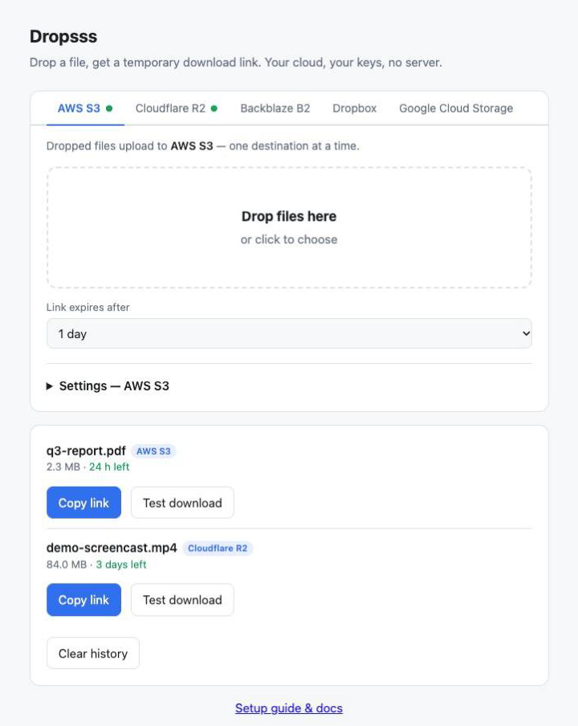

# Dropsss

Drop a file, get a temporary download link. Your cloud, your keys, no server.

Dropsss is a single HTML file that uploads files straight from your browser to **your own** cloud storage — AWS S3, Cloudflare R2, Backblaze B2, Google Cloud Storage, or Dropbox — and gives you a link that expires on its own. No backend, no install, no SDK. Open the file in your browser and drag something in.



## Features

* **Five destinations** in one tabbed UI — AWS S3, Cloudflare R2, Backblaze B2, Google Cloud Storage, Dropbox. Each tab configures only what that service needs.
* **Drag and drop uploads** straight from the browser, with a progress bar
* **Expiring links** — 1 hour, 1 day, 3 days or 7 days (Dropbox is a fixed 4 hours)
* **Link copied automatically** to your clipboard when the upload finishes
* **Private by default.** Buckets stay fully private; links work because they are signed
* **Upload history** of your recent links, tagged by provider, with time remaining on each
* **Zero dependencies.** Requests are signed (AWS SigV4 / Google GOOG4) in the browser using the built‑in Web Crypto API
* **Light and dark mode** that follows your system setting
* **One file.** Download `s3-drop.html`, open it, done. Works from `file://`.

## How it works

For S3, R2, B2 and GCS the page never needs a server:

1. It signs a short‑lived (15 min) upload URL and PUTs your file directly to your bucket, under `share/<random>/filename` so links can't be guessed.
2. It then signs a download URL with the expiry you picked and copies it to your clipboard.
3. When the link expires, the service rejects it. A lifecycle rule deletes the file itself after 7 days.

Dropbox works a little differently: the file is uploaded via the Dropbox API using a pasted access token, and the link comes from `get_temporary_link`, which Dropbox fixes at 4 hours.

Your files never pass through any third party — the page talks only to your chosen provider.

## Quick start

1. Download `s3-drop.html`.
2. Do the one‑time setup for the provider you want (below).
3. Open `s3-drop.html` in your browser, pick the provider tab, open **Settings**, fill in the fields and click **Save**.
4. Drop a file. Paste the link wherever you need it.

Settings auto‑open when a provider isn't configured yet, and collapse once it is. A green dot on a tab means that provider is ready. You can configure several providers and switch between them with the tabs.

## Providers

### AWS S3

| Field | Example |
| --- | --- |
| Bucket | `my-share-bucket` |
| Region | `us-west-2` |
| Access key ID | `AKIA...` |
| Secret access key | (from the IAM user) |
| Key prefix | `share/` |

**CORS** (bucket → Permissions → CORS):

```json
[{ "AllowedOrigins": ["*"], "AllowedMethods": ["PUT"],
   "AllowedHeaders": ["*"], "ExposeHeaders": ["ETag"], "MaxAgeSeconds": 3000 }]
```

**Lifecycle** (Management): expire objects under `share/` after 7 days.

**IAM user** with this inline policy, then create an access key (Application running outside AWS):

```json
{ "Version": "2012-10-17", "Statement": [{ "Effect": "Allow",
  "Action": ["s3:PutObject", "s3:GetObject"],
  "Resource": "arn:aws:s3:::YOUR-BUCKET/share/*" }] }
```

Keep **Block Public Access** on — links work because they are signed, not because the bucket is public.

### Cloudflare R2

R2 speaks the S3 API, so signing is identical (region `auto`).

| Field | Notes |
| --- | --- |
| Account ID | the `<account-id>` in your R2 S3 endpoint |
| Bucket | your bucket name |
| Access key ID / Secret | from an R2 API token |
| Key prefix | `share/` |

1. **API token:** R2 → *Manage R2 API Tokens* → create an *Object Read & Write* token scoped to your bucket. It gives an Access Key ID, a Secret, and the endpoint `https://<account-id>.r2.cloudflarestorage.com`.
2. **CORS** (bucket → Settings → CORS policy):

   ```json
   [{ "AllowedOrigins": ["*"], "AllowedMethods": ["PUT"],
      "AllowedHeaders": ["*"], "ExposeHeaders": ["ETag"] }]
   ```
3. **Lifecycle** (bucket → Settings → Object lifecycle rules): delete objects under `share/` after 7 days.

### Backblaze B2

B2 offers an S3‑compatible endpoint, so signing matches AWS.

| Field | Example |
| --- | --- |
| Bucket | your bucket name |
| Region | `us-west-004` (the region in your S3 endpoint) |
| Key ID / Application key | from an application key |
| Key prefix | `share/` |

1. **Application key:** Backblaze → *Application Keys* → add a key limited to your bucket. Copy the `keyID` and `applicationKey`.
2. **CORS** — allow `s3_put` from any origin. With the B2 CLI:

   ```bash
   b2 bucket update YOUR-BUCKET allPrivate --cors-rules '[{
     "corsRuleName": "drop",
     "allowedOrigins": ["*"], "allowedOperations": ["s3_put"],
     "allowedHeaders": ["*"], "exposeHeaders": ["etag"], "maxAgeSeconds": 3000 }]'
   ```
3. **Lifecycle** (bucket settings): keep only the last version and hide‑then‑delete after 7 days.

### Google Cloud Storage

GCS uses the same V4 scheme as AWS under the name `GOOG4-HMAC-SHA256`.

| Field | Notes |
| --- | --- |
| Bucket | your bucket name |
| HMAC access ID | starts with `GOOG` |
| HMAC secret | from the HMAC key |
| Key prefix | `share/` |

1. **HMAC key:** Cloud Storage → Settings → *Interoperability* → create an HMAC key for a service account.
2. **Grant** that service account object create/read on the bucket (role *Storage Object Admin*, or a custom role with `storage.objects.create` and `storage.objects.get`).
3. **CORS** — a `cors.json` allowing `PUT`:

   ```json
   [{ "origin": ["*"], "method": ["PUT"],
      "responseHeader": ["Content-Type"], "maxAgeSeconds": 3000 }]
   ```

   ```bash
   gcloud storage buckets update gs://YOUR-BUCKET --cors-file=cors.json
   ```
4. **Lifecycle:** delete objects after 7 days via a lifecycle rule on the bucket.

### Dropbox

Dropbox doesn't use signed URLs — it uses an OAuth access token and the Dropbox API. Two things to know:

* **Links are fixed at 4 hours** (`get_temporary_link`); the expiry selector doesn't apply.
* **The access token is short‑lived (~4 hours)**, so you re‑paste it from the App Console when it expires.

| Field | Notes |
| --- | --- |
| Access token | generated in the Dropbox App Console |
| Folder | `/drop/` |

1. **App:** [Dropbox App Console](https://www.dropbox.com/developers/apps) → Create app → *Scoped access*, pick Full Dropbox or App folder.
2. **Permissions** tab: enable `files.content.write` and `files.content.read`, then **Submit**.
3. **Token:** Settings tab → *Generated access token* → **Generate**, and paste it into the app.

No bucket and no CORS setup — Dropbox handles both.

## Security

* **Use a dedicated, narrowly scoped key** for each provider. Never use root or admin keys. With the policies above, a leaked key can only read and write `share/` in one bucket.
* **Credentials stay local.** Settings live in your browser's `localStorage` on your machine and are only used to sign requests. For S3/R2/B2/GCS the secret never leaves your browser — requests carry only a signature. For Dropbox the pasted token is sent to Dropbox (as it must be to call its API).
* **Avoid shared computers.** Anyone with access to that browser profile can read the stored key. Use **Forget credentials** if needed.
* **Links are bearer tokens.** Anyone who has the link can download the file until it expires. Treat links like the file itself.
* **Rotate keys** from the provider's console if you suspect a key has leaked.

## Limits

* **7‑day maximum** link lifetime for the signed‑URL providers (an AWS/GCS limit for V4 presigned URLs). **4 hours** for Dropbox.
* **5 GB maximum** file size for S3/R2/B2/GCS — a single PUT, not multipart. **150 MB** for Dropbox (single upload).
* **Lifecycle timing.** Providers run lifecycle deletion roughly daily, so files can linger a little past 7 days.

## Troubleshooting

| Problem | Likely cause |
| --- | --- |
| "Network or CORS error" | CORS rule missing or not saved on the bucket |
| "403: Access Denied" | Bucket/key in the policy doesn't match, or the prefix isn't `share/` |
| "SignatureDoesNotMatch" | Wrong secret, or the region doesn't match the bucket's region |
| "PermanentRedirect" | Region in Settings doesn't match the bucket's region |
| "RequestTimeTooSkewed" | Your computer's clock is off; sync it |
| Dropbox "expired_access_token" | Generate a fresh token in the App Console and re‑paste it |
| Link says "Request has expired" / 410 | Working as intended; upload again for a fresh link |

## Browser support

Any modern browser (Chrome, Edge, Firefox, Safari). Works when opened directly from disk via `file://`. Clipboard copy may need you to click **Copy link** in some browsers when running from a local file.

## License

MIT — see [LICENSE](LICENSE).
